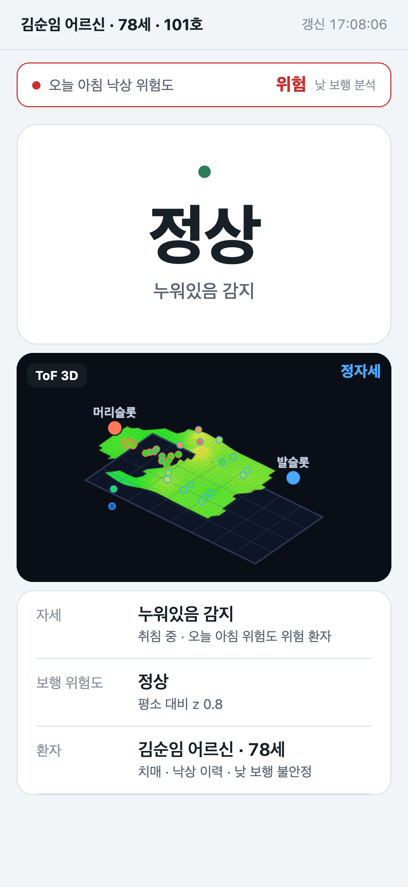
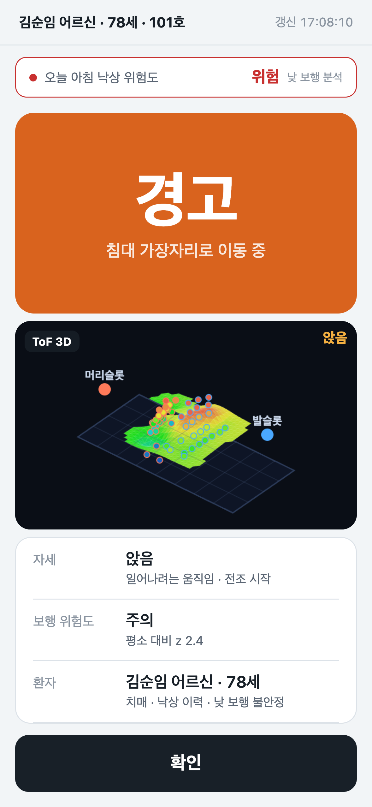
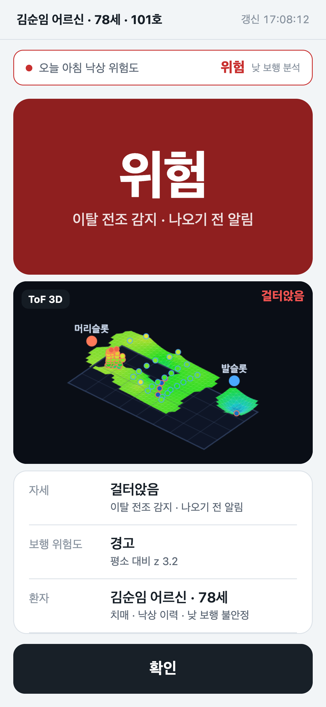
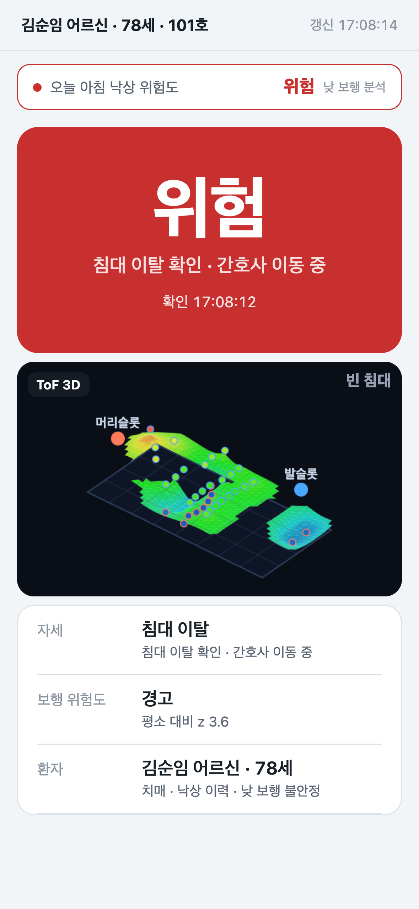

# 마주봄 간호사 알람 앱

MajuBom 서버의 위험 판정을 읽어 간호사 폰에 단계별 진동·소리·배너로 알리는 시연용 Expo 앱. 화면 1개.

## 화면

| 정상 | 경고 | 위험 | 침대 이탈 |
|---|---|---|---|
|  |  |  |  |

가운데 **ToF 3D** 칸은 서버의 3D 자세 뷰(`/tof/3d?embed=1`)를 그대로 띄운 것. 웹 대시보드와 같은 그림이다.

## 실행

```bash
npm install
npx expo start          # 폰의 Expo Go로 QR 스캔 (같은 와이파이)
```

첫 화면에서 라즈베리파이 IP(예: `192.168.6.10`)를 입력하면 `http://IP:5001`(ToF)과 `:5002`(mmWave)를 2초마다 읽는다.
상단 띠를 길게 누르면 주소를 다시 입력할 수 있다.

## 단계와 반응

| 단계 | 조건 (서버 값) | 폰 |
|---|---|---|
| 정상 | mmWave normal · ToF normal | 조용 |
| 주의 | mmWave caution | 짧은 진동 1회 |
| 경고 | mmWave warning 또는 ToF anomaly | 진동 2회 + 알림음 |
| 위험 | mmWave critical 또는 ToF anomaly + caution 이상 | 긴 진동 3회 반복 + 경보음 + 화면 점멸, 확인 전까지 |

단계가 **올라갈 때만** 울리고, 하단 **확인**을 누르면 멈춘다.

## 시연 트리거 (센서 없이)

MajuBom ToF 서버(5001)에 추가된 `/demo/alert`:

```bash
curl -X POST http://IP:5001/demo/alert -H 'Content-Type: application/json' -d '{"level":"caution"}'
curl -X POST http://IP:5001/demo/alert -H 'Content-Type: application/json' -d '{"level":"warning"}'
curl -X POST http://IP:5001/demo/alert -H 'Content-Type: application/json' -d '{"level":"critical"}'
curl -X POST http://IP:5001/demo/alert -H 'Content-Type: application/json' -d '{"level":"clear"}'
```

브라우저 주소창에서도 됨: `http://IP:5001/demo/alert?level=critical`. 파라미터 없이 열면 현재 값 조회.

## 피치 덱 영상과 자동 동기화

`majubom-pitch/demo-sync/index.html`(10번 슬라이드)이 영상 장면이 바뀔 때마다 `/demo/alert`로 단계·문구를 보낸다. 발표자는 아무것도 안 눌러도 된다.

| 영상 | 폰 |
|---|---|
| 0초 누움 | 정상 · 누워있음 감지 · 오늘 아침 낙상 위험도 **위험** |
| 11초 상체 일으킴 | 경고 · 일어나려는 움직임 · 전조 시작 |
| 16초 걸터앉음 | **위험** · 이탈 전조 감지 · 나오기 전 알림 → 알람 |
| 22초 이탈 | 위험 유지 · 침대 이탈 확인 |
| ↺ 처음 | 0초 상태로 |

덱을 열 때 서버 주소를 한 번 넘기면 브라우저에 저장된다. 이후엔 주소 없이 열어도 된다.

```
http://<덱 서버>/pitch.html?phone=http://<라즈베리파이 IP>:5001#10
```

`?phone=` 를 빈 값으로 주면 해제. 폰 앱은 0.5초마다 읽으므로 영상보다 최대 0.5초 늦게 바뀐다.

## 테스트

```bash
npm test            # 단계 판정(src/level.ts) 단위 테스트
npx tsc --noEmit
```

## 범위 밖
잠금화면·백그라운드 알림, 원격 푸시, 다중 병상, 알림 이력. (Expo Go는 백그라운드 실행 미지원.)
